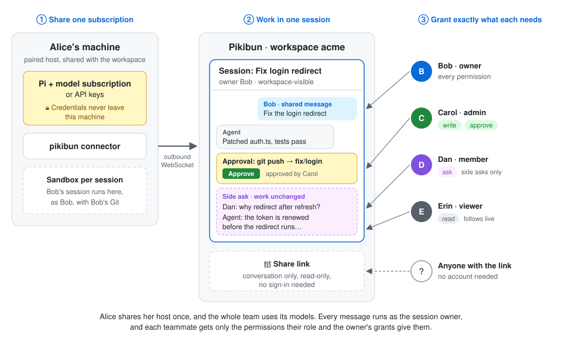

<p align="center"></p>

# Pikibun

Run [Pi](https://github.com/earendil-works/pi) coding agents on your own machines and work on them together with your team. Pikibun is a self-hosted control plane: a web app (with iPhone, iPad, Mac and Windows apps), a Node.js server, and the `pikibun` connector that each host runs to offer its local Pi to a workspace.

Its client is written once on [Native Shell](https://nsh.dev) (`apps/nsh`): `pikibun.com`, the Docker image and `pikibun serve` serve its web build, and `app-v` releases package it for each platform. The earlier React web client and Electron desktop app are removed.

Two things set it apart:

- **One subscription, the whole team.** Pair a machine where Pi is signed in to your model provider, share it with a workspace, and every teammate can start their own sessions on its models. They never see its API keys or subscription login: those stay on the host. Each session still runs as the member who started it, with their own Git accounts, so the team shares the models and not each other's identities. See [Sharing a host](docs/hosts.md#sharing-a-host).
- **Share a chat session, with exactly the permissions you choose.** Every session is a live conversation teammates can follow. Make it visible to the workspace or keep it private (the workspace's owner and admins still manage it), then give people exactly what they need: `read` to watch, `ask` for side questions that don't touch the work, `write` to drive it, `approve` to decide its commands and pushes, `manage` to share it further. A read-only link can show the conversation to anyone, even without signing in. See [Collaborating on a session](docs/collaboration.md).

<p align="center">
  
</p>

And around them:

- **Your machines, your models.** Sessions run on members' own hosts with the models and credentials configured in Pi there. A host connects over an outbound WebSocket: no inbound port or tunnel.
- **Isolated work.** Each session clones the workspace's repositories into its own sandbox, whose only way out is a proxy that reads them with the session owner's account and follows the workspace's network policy.
- **People decide.** Shell commands, commits, pushes, GitHub comments, merges and new issues wait for an approval unless the session owner auto-approves a message (a workspace's owner, admins and collaborators can auto-approve their own sandboxed commands in others' sessions).
- **Built for teams.** Workspace roles (viewer, member, collaborator, admin) set what each person can do by default, with the workspace's owner and admins managing every session in it, and session grants add more for one session at a time.

## Pi and pi-durable

Pikibun has no agent or model integrations of its own: it builds on two packages from [Pi](https://github.com/earendil-works/pi).

- **Pi** (`@earendil-works/pi-coding-agent`) is what you set up on each host. Install it and sign it in to your model provider there, as you would to use Pi in a terminal (the desktop app's **This Mac** can do the sign-in for you):

  ```sh
  npm install -g @earendil-works/pi-coding-agent
  pi    # then /login, or configure a provider and model
  ```

  The connector reads Pi's configuration (`~/.pi/agent`, or `--pi-agent-dir`). It offers the models matched by `enabledModels` in Pi's `settings.json` (every authenticated model when that is unset), takes reasoning levels and compaction settings from there, and loads extensions with Pi's own loader. Provider credentials stay in Pi on the host. Restart the connector after changing Pi's configuration. See [Hosts](docs/hosts.md#models).
- **pi-durable** (`@earendil-works/pi-durable`) is the agent runtime each session runs on, inside the connector, with nothing to install or configure. Sessions don't use Pi's interactive agent session. Each session is a durable conversation kept in its own SQLite database on the host: messages, tool calls and approvals are recorded as they happen. A session waiting on an approval, or interrupted by a connector restart, picks up where it stopped, and [backups and moves](docs/backups.md) carry that database. Pikibun's tools (sandboxed commands, Git, GitHub and others) and Pi's code mode are added as pi-durable extensions. For the same reason, the host's personal Pi extensions and `AGENTS.md` aren't loaded: a workspace chooses its sessions' [extensions](docs/extensions.md). See [Host extensions](docs/design/host-extensions.md) for how Pi extensions map onto pi-durable.

## Quick start

Just for yourself, on one computer:

```sh
npx pikibun@latest serve
```

It runs the server, the web app and your computer as its host, at `http://127.0.0.1:7878`. See [Running Pikibun on your own computer](docs/local.md).

For a team, [run the server](docs/self-hosting.md) with Docker, then pair each member's machine as a host:

```sh
npx pikibun@latest connect --server https://pikibun.example.com --pairing-id PAIRING_ID
```

The [quick start](docs/quick-start.md) walks through it step by step.

## Documentation

- [How it works](docs/how-it-works.md): the server, hosts and the main concepts
- [Quick start](docs/quick-start.md)
- Using Pikibun
  - [Signing in and your profile](docs/accounts.md)
  - [Workspaces and members](docs/workspaces.md)
  - [Repositories and Git accounts](docs/repositories.md): repositories, document sources and workspace connections
  - [Hosts](docs/hosts.md): pairing, models, sharing, the sandbox and network access
  - [Models and tools](docs/models-and-tools.md)
  - [Extensions](docs/extensions.md)
  - [Sessions](docs/sessions.md)
  - [Approvals and permission requests](docs/approvals.md)
  - [Notifications](docs/notifications.md): on the web, the Mac and Windows app, and iPhone and iPad
  - [Collaborating on a session](docs/collaboration.md)
  - [Commits, pushes and pull requests](docs/pushes.md)
  - [GitHub issues and pull requests](docs/github.md)
  - [Host commands](docs/host-commands.md)
  - [Backups, restores and moving sessions](docs/backups.md)
  - [iPhone, iPad, Mac and Windows apps](docs/apps.md)
- [Running Pikibun on your own computer](docs/local.md)
- [Running the server](docs/self-hosting.md): Docker, configuration, administration and storage
- [Development](docs/development.md): building, testing, releasing and the repository layout
- [Design notes](docs/design)

## Development

Requires Node 24 and pnpm.

```sh
pnpm install
cp apps/server/.env.example apps/server/.env   # then set the local settings in docs/development.md
pnpm build                                      # the web client into dist/client
pnpm dev:server                                 # API and web client on :8787
```

See [Development](docs/development.md) for signing in locally, tests and releases.

## Code signing policy

The apps on [GitHub Releases](https://github.com/OpenCara/pikibun/releases) are built by GitHub Actions from this repository ([`release-app.yml`](.github/workflows/release-app.yml)) and signed there:

- **Windows:** free code signing provided by [SignPath.io](https://signpath.io), certificate by [SignPath Foundation](https://signpath.org). The installer is signed; `Pikibun.exe` inside it is Native Shell's prebuilt runner ([longbridge/nsh](https://github.com/longbridge/nsh)), included as it is published. (Applied for: until SignPath Foundation accepts the project, the installer is released unsigned.)
- **macOS:** signed with OpenCara's Apple Developer ID and notarized by Apple.
- **Android:** signed with OpenCara's release key.

Team roles:

- Committers and reviewers: [members of OpenCara](https://github.com/orgs/OpenCara/people). Every change from anyone else is reviewed in a pull request.
- Approvers, who approve each signing request: [owners of OpenCara](https://github.com/orgs/OpenCara/people?query=role%3Aowner).

Privacy: the apps connect only to the Pikibun server you sign in to (`https://pikibun.com` unless you enter another address) and to the sites you choose to open from them. They send no telemetry, and transfer no information to any other networked system unless you ask them to. A server you sign in to keeps your account and sessions; one you run yourself keeps them on your own infrastructure.

## License

[MIT](LICENSE). Native Shell, which the apps are built with, is [Apache-2.0](https://github.com/longbridge/nsh/blob/main/LICENSE-APACHE).
