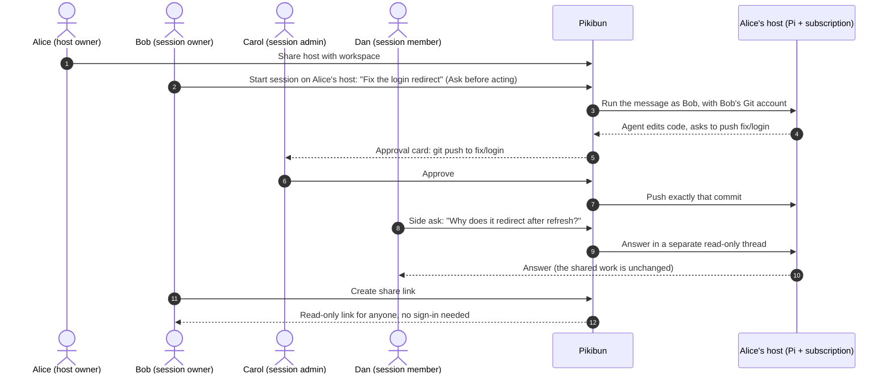

# Collaborating on a session

A session is a chat that can be shared. Teammates watch it live, ask side questions, send messages that drive the work, and approve its commands and pushes. Each person gets only what their session role, given by the session's owner, and their workspace role allow. Everything still runs as the session owner, whoever sends the message.

A typical day, with Alice's shared host from [Sharing a host](hosts.md#sharing-a-host):

## Visibility and session roles

- **Workspace-visible** sessions can be viewed by every workspace member: prompts, output, tool output, repository content shown in the transcript, and side asks. Collaborators and admins can also send them messages. **Private** sessions only by the owner, the workspace's owner and admins, and people with a grant. The owner, and the workspace's owner and admins, change visibility; making a session private keeps explicit grants but can't recall what was already seen.
- Session roles (**Details → People → Session roles**) give a workspace member one of four tiers of access to one session, named after the workspace roles. Each tier includes everything in the tiers below it. You can only give a tier whose permissions you hold, and the owner's own access can't be changed. A workspace viewer can only be a session viewer. Removing someone's session role doesn't take away what their workspace role gives them on a workspace-visible session (viewing, and for collaborators and admins messaging); making the session private does, except for the workspace's owner and admins, who manage every session.

| Session role | Permissions | Allows |
|---|---|---|
| **Viewer** | `read` | Viewing the session, its side asks, approvals and activity |
| **Member** | `read`, `ask` | Also sending side asks |
| **Collaborator** | `read`, `ask`, `write` | Also sending shared messages, stopping work and requesting operations |
| **Admin** | `read`, `ask`, `write`, `approve`, `manage` | Also deciding approvals (host commands also need a host command grant, and the host's owner decides them without this role; permission requests need the session owner) and managing who has a session role |

The API takes a tier (`POST /api/sessions/:id/grants` with `{ userId, role }`) or, as before, an explicit permission list (`{ userId, permissions }`). A grant that matches no tier, such as one made before tiers existed, shows as **Custom** until someone chooses a tier for it.

Only the session's owner can restart it, create its share link, back it up, restore, move or export it, use **Auto-approve**, schedule prompts, and decide permission requests. Its owner and the workspace's owner and admins rename, archive and unarchive it, change its visibility and tool output, and turn off its share link (see [Managing every session](workspaces.md#managing-every-session)).

## Share links

The owner can share a session by link (**Details → People → Create link**). Anyone who has the link can follow the shared conversation read-only, without signing in, with the session's title and the owner's display name. They see nothing else: no side asks, approvals, senders, host, workspace or repositories. **Turn off** (the owner, or the workspace's owner or an admin) stops the link at once, and turning sharing on again issues a new one; archived sessions can't get a new link. The token is carried only in the URL fragment (`#/shared/…`) and an `X-Share-Token` header, never in a request path, and the link pages read only `GET /api/shared` and `GET /api/shared/view`.

## Transcript size

A session's transcript comes from its host, which always sends Pikibun the whole conversation, compressed. Two settings make what reaches each viewer smaller. Both change only what Pikibun shows, so they work with every connector version:

- **Full tool output** (**Details → Transcript**, the session's owner, or the workspace's owner or an admin; `PATCH /api/sessions/:id` with `{"toolOutput": "brief"}` or `"full"`) is on by default. A workspace's owners and admins choose what new sessions there start with (**Settings → Workspaces →** the workspace **→ Transcripts → Full tool output**; `PUT /api/workspaces/:id/transcripts` with `{"toolOutput": "brief"}` or `"full"`); changing it leaves existing sessions as they are, and a session moved to another host or restored from a backup keeps its source's. Turned off, each tool result shows only the line that says what came of it (up to 200 characters), on its tool call's row in the transcript (see [Tool calls](sessions.md#tool-calls)): a command's last line of output, the lines a read got, the matches a search found, or the first line of other output; a call that failed stays marked. Long tool calls, such as a file the agent writes, keep each argument's first 100 characters, or, where that is still long, their first 200 characters. Tool output is most of a typical transcript, so long sessions then load roughly half as much. It applies to everyone viewing the session, its share link included. A shortened row says how many lines and characters the full output has; the host keeps all of it, and the agent still sees all of it. Secrets are hidden before anything is shortened.
- **Latest messages first** (**Settings → Workspaces →** the workspace **→ Transcripts**, owners and admins; `PUT /api/workspaces/:id/transcripts` with `{"paging": true}`; either setting may be sent alone, and one left out keeps its value) is off by default. Turned on, a session opens with only the newest 50 entries of each conversation. Earlier ones load 50 at a time as you scroll up, or with **Show earlier messages** at the top (`GET /api/sessions/:id/entries?conversation=…&before=…&limit=…`, up to 200). Entries you've already seen stay in place while new ones arrive. Your browser's find on the page only searches what has loaded. Share links aren't paged: they show the whole shared conversation.

Open sessions pick up either change within a few seconds.

## Hidden secrets

Everything Pikibun shows people (transcripts, approvals and their output, in every session view and share link) has values that look like secrets replaced by `[redacted]`, for everyone including the session's owner. That covers well-known token formats, private keys, the values of password-, secret-, token- and key-named settings, and credentials in URLs, Authorization headers, `curl -u` and `.netrc`. The agent and the host still see the real values, and an approved operation runs with them. In shell commands only single words are ever hidden, so an approver always sees what a command does, and an approval that holds a hidden value says so. Detection is pattern-based, so other sensitive text can still show; backups keep the real transcript.
