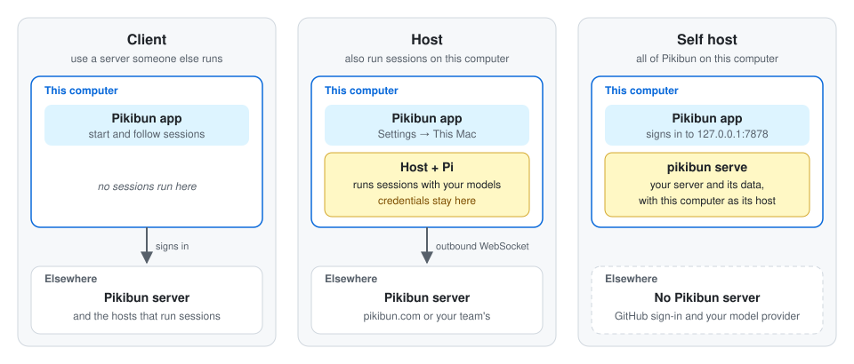

# Desktop app user guide

The Pikibun app for Mac, Windows and Linux can play three roles. Pick the one that matches how you want to use Pikibun, and switch whenever your needs change:

| Mode | Choose it when | What runs on this computer | Guide |
| --- | --- | --- | --- |
| **Client** | You use a Pikibun server someone else runs (`pikibun.com`, or your team's), and sessions run on other machines | Only the app | [Client](client.md) |
| **Host** | You also want this computer to run sessions, with the models Pi is signed in to here, for you or for teammates you share it with | The app, and the `pikibun` host it starts | [Host](host.md) |
| **Self host** | You want all of Pikibun on this computer, with no server to sign up for or deploy: just for yourself, or later shared with a team | Your own Pikibun server, and this computer as its host | [Self host](self-host.md) |

The modes build on each other. A host is a client that also runs sessions. A self-hosted Pikibun is a server on this computer, and the app is its client.

  

## Which one do I want?

- **"My team gave me an invite link"**, or **"I just want to try Pikibun on `pikibun.com`"**: start as a [client](client.md). If nobody has shared a host with you yet, become a [host](host.md) too, so your sessions have somewhere to run.
- **"I pay for a model subscription and want to use it from Pikibun"**: be a [host](host.md). Your provider's credentials stay in Pi on this computer. To let teammates use the same subscription, share the host with a workspace.
- **"I don't want my work on anyone else's server"**: [self host](self-host.md). The server, its data and the sessions all stay on this computer.

## Install the app

Download the latest `app-v` release from [GitHub Releases](https://github.com/OpenCara/pikibun/releases):

- **macOS** (Apple silicon): `Pikibun-<version>-macos-arm64.dmg`. Open it and drag **Pikibun** to **Applications**. Run it from **Applications**, not from the disk image, so that it can update itself.
- **Windows** (x64): `Pikibun-<version>-windows-x64-setup.exe`. It installs Pikibun for your user only, with no administrator rights needed.
- **Linux** (x86_64): `Pikibun-<version>-linux-x86_64.tar.gz`. Unpack it into a folder you can write to, and start `Pikibun` from that folder.

The app checks for new releases when it starts and every six hours. You can also check under **Settings → Profile → This app**. See **Updates** on [the apps page](../apps.md) for how an update installs.

## Switching between modes

Nothing has to be reinstalled. You switch with one setting, or by signing in to another server:

| From → to | How |
| --- | --- |
| Client → Host | **Settings → This Mac** (**This Computer** on Windows and Linux) → **Pair This Mac**. After that, use **Start host**. See [Host](host.md). |
| Host → Client | **Settings → This Mac → Stop host**. The pairing is kept, so **Start host** brings it back later without a new code. |
| Any → Self host | Start `pikibun serve` in a terminal, then sign in to `http://127.0.0.1:7878`: **Settings → Profile → Sign out**, then **Change** next to **Server** on the sign-in screen. See [Self host](self-host.md). |
| Self host → Client or Host | Sign out, then **Change** the server back (for example to `https://pikibun.com`). Stop `pikibun serve` in its terminal with Ctrl+C when you no longer need it. |

Keep in mind:

- **The app is signed in to one server at a time.** Signing out of one and in to another doesn't change any server: your sessions, workspaces and hosts stay on the server they belong to.
- **This Mac hosts for one server at a time.** It keeps running for the server it's paired with even after you sign in to another one. The page then reads *This Mac is a host of …* with that server's name. To host for the server you're signed in to now, choose **Stop host**, then pair again. Pairing again replaces the old pairing. The old host stays on the previous server, offline, until you remove it there.
- **Hosting lasts while the app is open.** Quitting the app stops the host. If the host was running when you quit, it starts again at the next launch.
