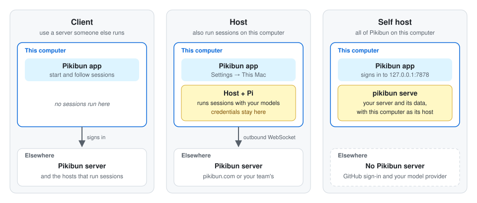

# Desktop app user guide

The Pikibun app for Mac, Windows and Linux can play three roles. Pick the one that matches how you want to use Pikibun, and switch whenever your needs change:

| Mode | Choose it when | What runs on this computer | Guide |
| --- | --- | --- | --- |
| **Client** | You use a Pikibun server someone else runs (`pikibun.com`, or your team's), and sessions run on other machines | Only the app | [Client](client.md) |
| **Host** | You also want this computer to run sessions, with the models Pi is signed in to here, for you or for teammates you share it with | The app, and the `pikibun` host it starts | [Host](host.md) |
| **Self host** | You want all of Pikibun on this computer, with no server to sign up for or deploy: just for yourself, or later shared with a team | Your own Pikibun server, and this computer as its host | [Self host](self-host.md) |

A fresh install starts in **Self host**: at its first launch the app runs your own Pikibun on this computer and signs you in, and offers **Sign in to another server** for the other two.

The modes build on each other. A host is a client that also runs sessions. A self-hosted Pikibun is a server on this computer, and the app is its client.

  

## Which one do I want?

- **"My team gave me an invite link"**, or **"I just want to try Pikibun on `pikibun.com`"**: start as a [client](client.md). If nobody has shared a host with you yet, become a [host](host.md) too, so your sessions have somewhere to run.
- **"I pay for a model subscription and want to use it from Pikibun"**: be a [host](host.md). Your provider's credentials stay in Pi on this computer. To let teammates use the same subscription, share the host with a workspace.
- **"I don't want my work on anyone else's server"**: [self host](self-host.md). The server, its data and the sessions all stay on this computer.

## Install the app

Download the latest `app-v` release from [GitHub Releases](https://github.com/OpenCara/pikibun/releases):

- **macOS** (Apple silicon): `Pikibun-<version>-macos-arm64.dmg`. Open it and drag **Pikibun** to **Applications**. Run it from **Applications**, not from the disk image, so that it can update itself.
- **Windows** (x64): `Pikibun-<version>-windows-x64-setup.exe`. It installs Pikibun for your user only, with no administrator rights needed.
- **Linux** (x86_64): `Pikibun-<version>-linux-x86_64.tar.gz`. Unpack it into a folder you can write to, and start `Pikibun` from that folder.

The app checks for new releases when it starts and every six hours, and offers a newer one on its main page: **Update and restart** downloads and installs it, through the proxy your computer's settings or your shell's `https_proxy` name, if any. You can also check under **Settings → Profile → This app**. See **Updates** on [the apps page](../apps.md) for how an update installs. The first time an updated app starts, it also updates the `pikibun` command it installed for [host](host.md) and [self host](self-host.md).

## Switching between modes

Nothing has to be reinstalled. You switch with one setting, or by signing in to another server:

| From → to | How |
| --- | --- |
| Client → Host | **Settings → This Mac** (**This Computer** on Windows and Linux) **→ Local hosts → Pair host**. After that, use **Start**. See [Host](host.md). |
| Host → Client | **Settings → This Mac → Local hosts → Stop** on each host. Its pairing is kept, so **Start** brings it back later without a new code. |
| Any → Self host | **Pikibun on this Mac** in the sidebar's server switch, or **Settings → This Mac → Self host → Start Pikibun**, then **Sign in to it**. Signed out, the sign-in screen's **Run Pikibun on this Mac** opens the same page. See [Self host](self-host.md). |
| Self host → Client or Host | The sidebar's server switch, or **Settings → Profile → Servers → Switch**, changes to a server you're signed in to, or **Add a server** (for example `https://pikibun.com`); see [Switching between servers](client.md#switching-between-servers). Choose **Stop** under **Settings → Self host** when you no longer need your own Pikibun. |

Settings come in two sets. The server you're signed in to has its own, under its address: **Profile**, **Password**, **Notifications**, **Hosts** (every host you own on that server, wherever it runs), **Workspaces** and **Administration**. This computer has the rest, under **This Mac** (**This Computer** on Windows and Linux): **Local hosts**, **Self host** and **Appearance**. Switching servers changes only the first set.

Keep in mind:

- **The app is signed in to one server at a time.** Signing out of one and in to another doesn't change any server: your sessions, workspaces and hosts stay on the server they belong to.
- **This Mac can run several hosts at once**: for several servers, or more than one for the same server with different settings (on Windows, one in Windows' own sandbox and one in WSL2, say). **Settings → This Mac → Local hosts** lists them all, whichever server you're signed in to, where you start, stop, add or remove each. Each host keeps running when you sign in to another server, and its server's sessions run on it while it is online. A private session whose host is one of This Mac's, opened while that host isn't running, says so and offers **Start host** or **Connect This Mac**.
- **Hosting and self hosting last while the app is open.** Quitting the app stops them. Whatever was running when you quit starts again at the next launch.
